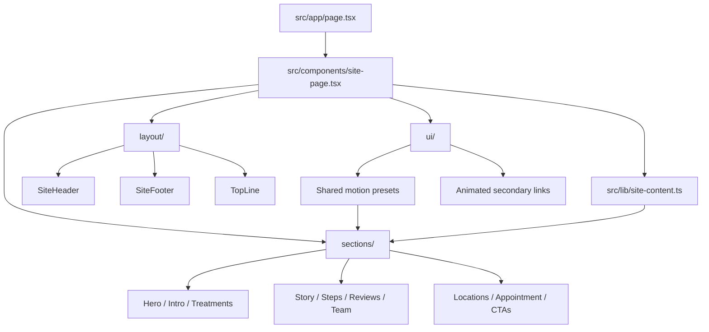
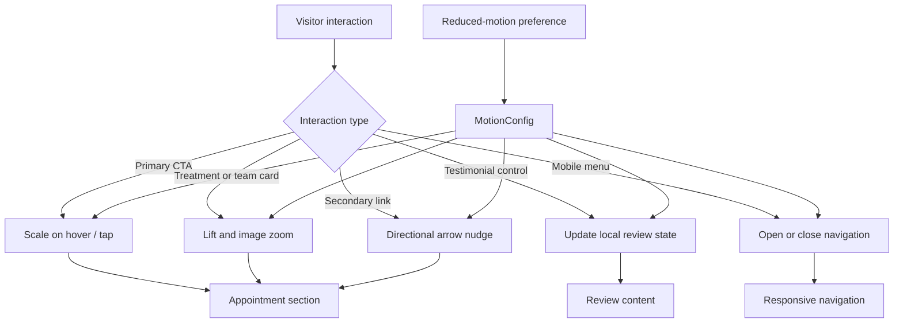
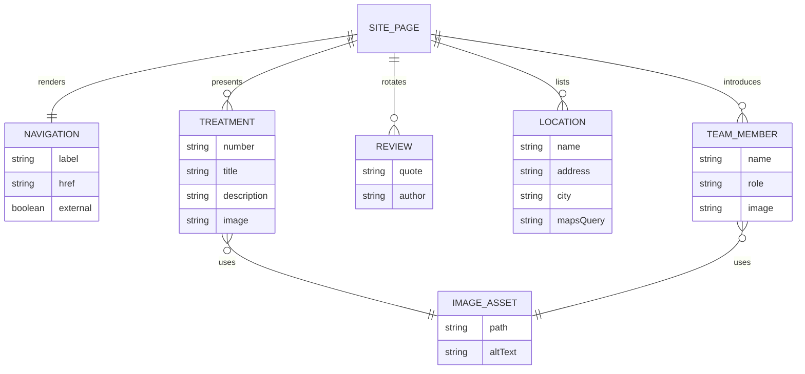
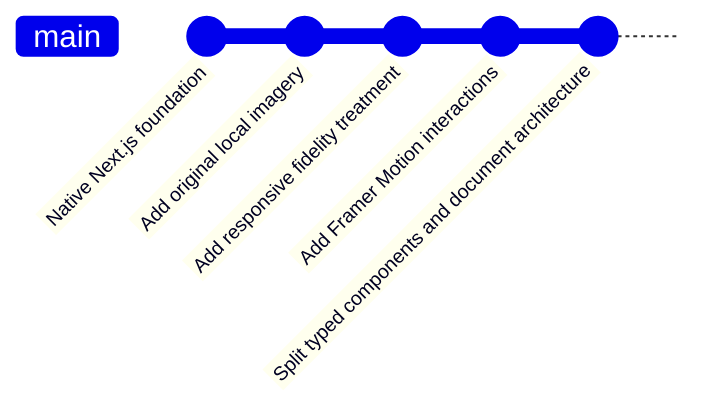

# Clear Creek Chiropractic

Native Next.js App Router modernization of the Clear Creek Chiropractic homepage. The implementation keeps the original visual language and imagery while adding responsive behavior, accessible controls, and Framer Motion interactions.

## Stack

- Next.js 16 App Router with React 19
- TypeScript with strict checking
- Framer Motion for interaction and transitions
- Lucide React for interface icons
- Vercel-ready static page output

## Project structure

```text
src/
├── app/
│   ├── globals.css       # Global design system and responsive layout
│   ├── icon.png          # Favicon
│   ├── layout.tsx        # Metadata and global providers
│   └── page.tsx          # Route entry point
├── components/
│   ├── layout/           # Header, utility bar, and footer
│   ├── sections/         # Page sections grouped by responsibility
│   ├── ui/               # Motion presets and reusable links
│   ├── motion.tsx        # Global reduced-motion provider
│   └── site-page.tsx     # Shallow page composition
└── lib/
    └── site-content.ts   # Typed copy, links, locations, and media data
```

## Scripts

These commands are defined in `package.json`:

| Command | Purpose |
| --- | --- |
| `npm run dev` | Start the local development server |
| `npm run build` | Create the optimized production build |
| `npm run start` | Serve the production build locally |
| `npm run lint` | Run Next.js ESLint checks |
| `npm run typecheck` | Run TypeScript without emitting files |

## Local development

```bash
npm install
npm run dev
```

Open [http://localhost:3000](http://localhost:3000) in a browser.

## Quality checks

```bash
npm run lint
npm run typecheck
npm run build
```

The appointment form is intentionally presentation-only until the clinic's preferred booking or CRM endpoint is connected.

## Architecture

The route stays intentionally thin. It mounts the shared motion provider and delegates the page composition to the organized component tree.



## Page composition

The homepage follows the original site's narrative order: introduce the practice, explain care, build trust, show the team, then convert the visitor.

```mermaid
flowchart LR
    A[Utility bar] --> B[Header]
    B --> C[Hero: More movement]
    C --> D[Care philosophy]
    D --> E[Treatment cards]
    E --> F[Practice story]
    F --> G[Three-step visit guide]
    G --> H[Patient reviews]
    H --> I[Team cards]
    I --> J[Locations]
    J --> K[Appointment request]
    K --> L[Attorney referral]
    L --> M[Final CTA]
    M --> N[Footer]
```



## Interaction model

All primary controls and cards use Framer Motion. The global provider respects reduced-motion preferences while preserving keyboard and native browser behavior.



## Content and asset map

Typed content models keep copy and media references separate from presentation components.



## Deployment flow


